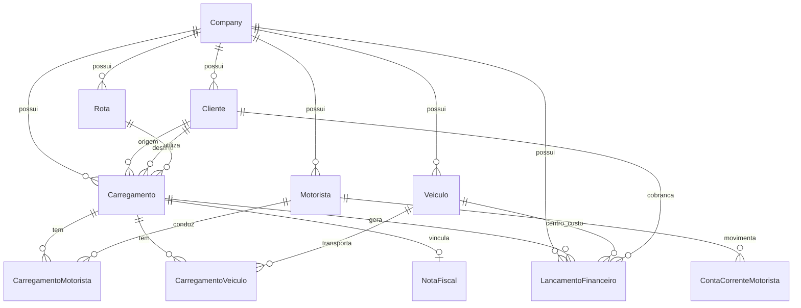
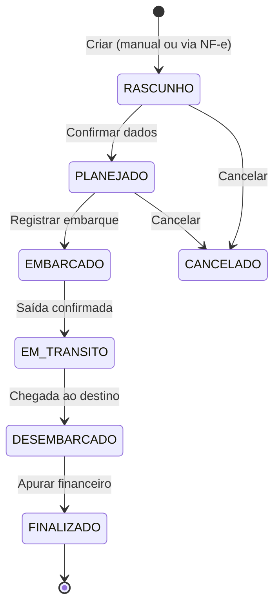

# Atlas Boi — Plano Completo do Projeto

> **Versão:** 1.6 · **Data:** Julho/2026  
> **Autor:** Engenharia Atlas Technologies  
> **Status:** Fase 4 concluída (~95%) — Fase 5 em andamento (~85%: push/offline/Rota Brain no PWA)

---

## Manifesto

```
┌─────────────────────────────────────────────────────────────────┐
│                                                                 │
│   ❌  Power BI          →  licença, exportação, outro sistema   │
│   ❌  Metabase/Grafana  →  BI de negócio terceirizado           │
│                                                                 │
│   ✅  PostgreSQL        →  dados + relatórios + inteligência  │
│   ✅  Nossa aplicação   →  telas, gráficos, export PDF/Excel    │
│   ✅  Atlas Intelligence → IA que entende boi, rota e frete  │
│                                                                 │
│   "O Postgres guarda. O Postgres calcula. O Postgres responde." │
│                                                                 │
└─────────────────────────────────────────────────────────────────┘
```

**Três pilares:**

1. **PostgreSQL é o cérebro** — não só armazena; calcula DRE, apura comissão, ranqueia frota, detecta anomalias. Views materializadas, funções, window functions, PostGIS. Tudo no banco que já conhecemos e confiamos.

2. **Relatórios vivem na aplicação** — Recharts + TanStack Table + export PDF/Excel. Sem licença por usuário, sem exportar CSV para outra ferramenta, sem dashboard que ninguém mantém.

3. **Inteligência embarcada (Atlas Intelligence)** — IA não como enfeite, mas como copiloto: importa NF-e sozinha, responde perguntas em português, sugere rotas, alerta margens estranhas, lê comprovante de pedágio por foto.

---

## Sumário

1. [Visão e Propósito](#1-visão-e-propósito)
2. [Posicionamento no Ecossistema Atlas](#2-posicionamento-no-ecossistema-atlas)
3. [Análise de Mercado — Sistemas Prontos vs. Atlas Boi](#3-análise-de-mercado--sistemas-prontos-vs-atlas-boi)
4. [Arquitetura Tecnológica](#4-arquitetura-tecnológica)
5. [Multi-Tenancy — Um Sistema, Vários Clientes](#5-multi-tenancy--um-sistema-vários-clientes)
6. [Modelagem de Dados (PostgreSQL)](#6-modelagem-de-dados-postgresql)
7. [Módulos Funcionais](#7-módulos-funcionais)
8. [Motor Financeiro Unificado](#8-motor-financeiro-unificado)
9. [Importação de NF-e (XML) e Documentos Fiscais](#9-importação-de-nf-e-xml-e-documentos-fiscais)
10. [Fluxos Operacionais](#10-fluxos-operacionais)
11. [PostgreSQL — O Motor de Inteligência](#11-postgresql--o-motor-de-inteligência)
12. [Relatórios Nativos na Aplicação](#12-relatórios-nativos-na-aplicação)
13. [Atlas Intelligence — IA Embarcada](#13-atlas-intelligence--ia-embarcada)
14. [Aplicativo do Motorista](#14-aplicativo-do-motorista)
15. [Regras de Negócio e Compliance](#15-regras-de-negócio-e-compliance)
16. [CNPJ Alfanumérico (Nova Regra 2026)](#16-cnpj-alfanumérico-nova-regra-2026)
17. [Segurança, Auditoria e LGPD](#17-segurança-auditoria-e-lgpd)
18. [Roadmap de Implementação](#18-roadmap-de-implementação)
19. [Estimativa de Custos e ROI](#19-estimativa-de-custos-e-roi)
20. [Diferenciais — Por Que o Atlas Boi Surpreende](#20-diferenciais--por-que-o-atlas-boi-surpreende)
21. [Próximos Passos Imediatos](#21-próximos-passos-imediatos)

---

## 1. Visão e Propósito

### O Problema

Transportadoras de gado vivo operam hoje com **planilhas, WhatsApp e sistemas genéricos de TMS** que não entendem a pecuária: múltiplos motoristas por viagem, comissão por KM, adiantamento com prestação de contas, valor da carga vinculado à NF-e, pedágio/balança por rota, e a necessidade de enxergar **rentabilidade por caminhão** como se cada veículo fosse uma empresa.

### A Solução

**Atlas Boi** é um ERP vertical SaaS para transporte de bovinos, construído sobre o mesmo DNA do ecossistema Atlas (`atlas-erp`), com:

- Controle operacional de **carregamentos** (embarque → trânsito → desembarque)
- Cadastros inteligentes de **clientes, rotas, motoristas e veículos**
- **Motor financeiro unificado** — um único ponto de lançamento que distribui para conta corrente do motorista, cobrança do cliente ou centro de custo do veículo
- **PostgreSQL como motor de inteligência** — DRE, KPIs, rankings e alertas calculados no banco
- **Relatórios nativos** na aplicação — gráficos interativos, export PDF/Excel, zero Power BI
- **Atlas Intelligence** — IA embarcada para NF-e, consultas em português e copiloto operacional
- **Multi-tenant** desde o dia zero — uma instância, N transportadoras

### Personas

| Persona | Necessidade principal |
|---------|----------------------|
| **Diretor / Dono** | DRE por veículo, margem por rota, fluxo de caixa |
| **Operacional** | Registrar carregamentos, vincular motoristas/placas, acompanhar status |
| **Financeiro** | Adiantamentos, comissões, cobrança de clientes, conciliação |
| **Motorista** | Ver saldo, lançar despesas, anexar comprovantes, prestar contas |
| **Admin SaaS** | Gerenciar tenants, planos, módulos e billing |

---

## 2. Posicionamento no Ecossistema Atlas

```
Atlas Technologies (Holding)
├── Atlas Core          → Auth, multi-tenant, planos, RBAC, billing
├── Atlas ERP           → TMS genérico (base compartilhada)
├── Atlas Boi  ◄────────→ Vertical transporte de gado (ESTE PROJETO)
├── Atlas Hub           → CPQ / cotação logística com IA
└── Atlas Digital       → Atendimento omnichannel
```

### Estratégia de Código

O **Atlas Boi** nasce como produto vertical **independente** (`atlas-boi/`), mas **reutiliza padrões e, quando possível, módulos** do `atlas-erp`:

| Camada | Reutilizar do atlas-erp | Específico do Atlas Boi |
|--------|-------------------------|-------------------------|
| SaaS Core | Company, Plan, Module, Role, User, Auth, RBAC | Módulos e planos verticais |
| Operacional | Motorista, Veículo (base) | Carregamento, Rota, Cliente, Animais |
| Financeiro | — (stub no ERP) | Ledger unificado, CC motorista, DRE veículo |
| Relatórios | Placeholders | Engine completa in-app |

> **Decisão de engenharia:** extrair `Atlas Core` como pacote npm interno (`@atlas/core`) na Fase 2, evitando duplicação de auth/tenant/RBAC.

---

## 3. Análise de Mercado — Sistemas Prontos vs. Atlas Boi

### Sistemas Existentes

| Sistema | Foco | O que faz bem | O que NÃO resolve para você |
|---------|------|---------------|----------------------------|
| **Uboi (JBS)** | Marketplace de frete de gado | App, telemetria, bem-estar animal, frota própria | CC motorista, comissão customizada, DRE por veículo, multi-tenant para transportadoras independentes |
| **Omie / TOTVS TMS** | ERP transportadora genérico | CT-e, MDF-e, financeiro contábil | Rotas pecuárias, KM/comissão por rota, importação NF-e de carga de gado, CC motorista |
| **Brazsoft / iRancho** | Gestão de fazenda | Rebanho, manejo, nutrição | Transporte rodoviário, motoristas, comissões |
| **Soften ERP Agro** | Agro geral | NF-e, estoque, safra | Transporte vivo detalhado |
| **Planilhas + WhatsApp** | — | Flexibilidade | Zero rastreabilidade, erro humano, sem relatórios |

### Veredicto

> **Não existe no mercado brasileiro um SaaS multi-tenant que una transporte de gado + conta corrente de motorista + comissão por rota + DRE por veículo + importação NF-e — com relatórios nativos.**

O Uboi é excelente para **contratar frete** (lado embarcador). O Atlas Boi é excelente para **gerir a transportadora** (lado operador/frota).

### Onde o Atlas Boi se encaixa

```
┌─────────────────┐     contrata frete      ┌─────────────────┐
│  Embarcador     │ ──────────────────────► │  Uboi / similar │
│  (pecuarista)   │                         │  (marketplace)  │
└─────────────────┘                         └─────────────────┘
         │                                           │
         │ NF-e / GTA                                │ viagem
         ▼                                           ▼
┌─────────────────────────────────────────────────────────────┐
│                    ATLAS BOI                                 │
│  Transportadora gerencia: frota, motoristas, rotas,         │
│  financeiro, comissões, cobrança, DRE por veículo           │
└─────────────────────────────────────────────────────────────┘
```

---

## 4. Arquitetura Tecnológica

### Stack Oficial (padrão Atlas — PostgreSQL no centro)

```
┌──────────────────────────────────────────────────────────────┐
│                        FRONTEND WEB                          │
│  Next.js 14 · Recharts · TanStack Table · Copilot UI        │
│  Export: xlsx · jspdf · react-to-print                      │
└──────────────────────────┬───────────────────────────────────┘
                           │ REST /api
┌──────────────────────────▼───────────────────────────────────┐
│                        BACKEND API                           │
│  NestJS 10 · Prisma 5 · Atlas Intelligence Module            │
└──────────────────────────┬───────────────────────────────────┘
                           │
┌──────────────────────────▼───────────────────────────────────┐
│              ★  PostgreSQL 16 — O CÉREBRO  ★                 │
│                                                              │
│  Tabelas transacionais · Views materializadas · Funções PL/pgSQL │
│  DRE por veículo · Saldo CC motorista · Rankings · PostGIS   │
│  pg_cron (snapshots) · RLS multi-tenant · JSONB (configs)    │
│  Full-text search · LISTEN/NOTIFY (dashboards ao vivo)       │
│                                                              │
│  → Relatórios = SELECT. Inteligência = SQL + IA em cima.     │
└──────────┬───────────────────────────────┬───────────────────┘
           │                               │
┌──────────▼──────────┐         ┌──────────▼──────────┐
│  Redis 7            │         │  MinIO / S3         │
│  cache de views     │         │  XML, comprovantes  │
└─────────────────────┘         └─────────────────────┘
```

> **Grafana/Prometheus** ficam restritos à **observabilidade de infra** (CPU, memória, latência de API) — nunca para BI de negócio. Relatório de margem por rota? **Postgres.**

### Estrutura de Pastas

```
atlas-boi/
├── backend/
│   ├── prisma/
│   │   ├── schema.prisma
│   │   ├── migrations/
│   │   └── seed.ts
│   └── src/
│       ├── common/          # guards, decorators, filters, utils
│       └── modules/
│           ├── auth/
│           ├── companies/
│           ├── clientes/
│           ├── rotas/
│           ├── motoristas/
│           ├── veiculos/
│           ├── carregamentos/
│           ├── financeiro/   # ledger unificado
│           ├── nfe/          # importação XML
│           ├── intelligence/ # Atlas Intelligence (NF-e Brain, Query Brain, Ops Brain)
│           ├── relatorios/   # endpoints que consomem views Postgres
│           └── dashboard/
├── frontend/
│   ├── app/
│   │   ├── (auth)/
│   │   └── dashboard/
│   │       ├── carregamentos/
│   │       ├── clientes/
│   │       ├── rotas/
│   │       ├── motoristas/
│   │       ├── veiculos/
│   │       ├── financeiro/
│   │       └── relatorios/
│   ├── components/
│   ├── services/
│   ├── hooks/
│   └── lib/
├── docs/
├── docker-compose.yml
└── README.md
```

### API — Padrão de Resposta

```json
{
  "success": true,
  "message": "Carregamento registrado com sucesso",
  "data": { "id": "clx...", "status": "EM_TRANSITO" },
  "meta": { "page": 1, "total": 42 }
}
```

### Infraestrutura

| Ambiente | Propósito |
|----------|-----------|
| **dev** | Docker Compose local (Postgres + Redis + API + Web) |
| **staging** | VPS ou cloud — espelho de prod para homologação |
| **prod** | Cloud (AWS/Azure/Hetzner) — Postgres gerenciado, backups diários |

---

## 5. Multi-Tenancy — Um Sistema, Vários Clientes

### Modelo: Shared Database, Row-Level Isolation

Mesmo padrão do `atlas-erp`:

- Cada **tenant = Company** (transportadora)
- **Toda tabela operacional** possui `companyId`
- JWT contém `companyId` — services filtram automaticamente
- **Zero vazamento** entre tenants (testes de isolamento obrigatórios)

### Hierarquia SaaS

```
Platform Admin (Atlas)
    └── Company (Tenant — Transportadora A, B, C...)
            └── Users (com Role + Permissions)
            └── Dados operacionais (scoped por companyId)
```

### Planos e Módulos

| Plano | Módulos | Público |
|-------|---------|---------|
| **Starter** | Cadastros, Carregamentos, Relatórios básicos | 1-5 veículos |
| **Professional** | + Financeiro, Comissões, NF-e, DRE veículo | 6-30 veículos |
| **Enterprise** | + Multi-filial, API, mobile, integrações bancárias | 30+ veículos |

### Usuário Multi-Empresa

Um usuário pode pertencer a **N companies** (`UserCompany`), com role diferente em cada — útil para contadores e consultores.

---

## 6. Modelagem de Dados (PostgreSQL)

### Diagrama ER Simplificado



### 6.1 Cliente (Embarque / Desembarque / Ambos)

```prisma
enum ClienteTipo {
  EMBARQUE
  DESEMBARQUE
  AMBOS
}

enum DocumentoTipo {
  CPF
  CNPJ
}

model Cliente {
  id              String        @id @default(cuid())
  companyId       String
  company         Company       @relation(...)

  tipoDocumento   DocumentoTipo
  documento       String        // raw: CPF 11 dígitos ou CNPJ 14 alfanuméricos
  nome            String
  nomeFantasia    String?

  // Endereço completo
  cep             String?
  logradouro      String?
  numero          String?
  complemento     String?
  bairro          String?
  cidade          String
  uf              String        @db.Char(2)
  codigoIbge      String?

  // Geolocalização
  latitude        Decimal?      @db.Decimal(10, 7)
  longitude       Decimal?      @db.Decimal(10, 7)

  tipo            ClienteTipo   @default(AMBOS)
  ativo           Boolean       @default(true)

  // Relações
  carregamentosOrigem   Carregamento[] @relation("OrigemCliente")
  carregamentosDestino  Carregamento[] @relation("DestinoCliente")
  lancamentos           LancamentoFinanceiro[]

  @@unique([companyId, documento])
  @@index([companyId, tipo])
  @@index([companyId, cidade, uf])
}
```

**Inteligência de cadastro:** ao digitar CNPJ, busca automática via Brasil API (padrão Atlas). Ao selecionar cliente embarque/desembarque no carregamento, origem/destino/endereço são **pré-preenchidos**.

### 6.2 Rota

```prisma
model Rota {
  id                    String   @id @default(cuid())
  companyId             String

  codigo                String   // ex: "SP-GO-001"
  descricao             String   // "Barretos → Goiânia"

  clienteOrigemId       String?
  clienteOrigem         Cliente? @relation("RotaOrigem", ...)
  clienteDestinoId      String?
  clienteDestino        Cliente? @relation("RotaDestino", ...)

  // Texto livre (fallback se cliente não cadastrado)
  origemTexto           String?
  destinoTexto          String?

  distanciaKm           Decimal  @db.Decimal(10, 2)

  // Valores fixos da rota
  valorPedagio          Decimal  @default(0) @db.Decimal(12, 2)
  valorBalanca          Decimal  @default(0) @db.Decimal(12, 2)

  // Tarifas por KM
  valorKmCobrancaCliente    Decimal @db.Decimal(12, 4)  // R$/km cobrado do cliente
  valorKmComissaoMotorista  Decimal @db.Decimal(12, 4)  // R$/km pago ao motorista

  // Opcional: percentual sobre valor da carga
  percentualComissao    Decimal? @db.Decimal(5, 2)

  ativa                 Boolean  @default(true)
  carregamentos         Carregamento[]

  @@unique([companyId, codigo])
}
```

### 6.3 Motorista

```prisma
model Motorista {
  id              String   @id @default(cuid())
  companyId       String

  nome            String
  cpf             String?
  cnh             String?
  cnhCategoria    String?
  cnhValidade     DateTime?
  telefone        String?
  email           String?

  // Configuração de comissão padrão (override da rota)
  tipoComissao    TipoComissao @default(POR_KM)
  valorComissaoKm Decimal?     @db.Decimal(12, 4)
  percentualComissao Decimal?   @db.Decimal(5, 2)

  ativo           Boolean  @default(true)

  carregamentos   CarregamentoMotorista[]
  contaCorrente   ContaCorrenteMotorista[]
  lancamentos     LancamentoFinanceiro[]

  @@unique([companyId, cpf])
}

enum TipoComissao {
  POR_KM
  PERCENTUAL_CARGA
  VALOR_FIXO
  MISTO           // km + percentual
}
```

### 6.4 Veículo (Centro de Custo)

```prisma
model Veiculo {
  id              String   @id @default(cuid())
  companyId       String

  placa           String
  renavam         String?
  modelo          String?
  marca           String?
  ano             Int?
  tipo            TipoVeiculo @default(CAMINHAO)

  // Centro de custo
  codigoCentroCusto String?  // ex: "CC-001"
  descricaoCentroCusto String?

  ativo           Boolean  @default(true)

  carregamentos   CarregamentoVeiculo[]
  lancamentos     LancamentoFinanceiro[]

  @@unique([companyId, placa])
}

enum TipoVeiculo {
  CAMINHAO
  CARRETA
  JULIETA
  TOCO
  OUTRO
}
```

### 6.5 Carregamento (Núcleo Operacional)

```prisma
enum CarregamentoStatus {
  RASCUNHO
  PLANEJADO
  EMBARCADO          // saiu da origem
  EM_TRANSITO
  DESEMBARCADO       // chegou ao destino
  FINALIZADO         // financeiro fechado
  CANCELADO
}

model Carregamento {
  id                String             @id @default(cuid())
  companyId         String
  numero            String             // sequencial por tenant: "CAR-2026-00042"

  status            CarregamentoStatus @default(RASCUNHO)

  // Origem / Destino
  clienteOrigemId   String
  clienteOrigem     Cliente            @relation("OrigemCliente", ...)
  clienteDestinoId  String
  clienteDestino    Cliente            @relation("DestinoCliente", ...)

  // Rota (opcional — pode calcular KM manualmente)
  rotaId            String?
  rota              Rota?              @relation(...)

  // Datas
  dataEmbarque      DateTime?
  dataDesembarque   DateTime?
  dataPrevisaoDesembarque DateTime?

  // Animais
  quantidadeAnimais Int
  pesoMedioEstimado Decimal?           @db.Decimal(10, 2)  // kg/cabeça
  pesoTotal         Decimal?           @db.Decimal(12, 2)

  // Quilometragem
  kmRota            Decimal?           @db.Decimal(10, 2)  // da rota ou manual
  kmReal            Decimal?           @db.Decimal(10, 2)  // odômetro real

  // Valor da carga
  valorCarga        Decimal?           @db.Decimal(14, 2)
  notaFiscalId      String?
  notaFiscal        NotaFiscal?        @relation(...)

  // Valores calculados (snapshot no fechamento)
  valorFreteCliente     Decimal?       @db.Decimal(14, 2)
  valorComissaoTotal    Decimal?       @db.Decimal(14, 2)
  valorPedagio          Decimal?       @db.Decimal(12, 2)
  valorBalanca          Decimal?       @db.Decimal(12, 2)
  margemBruta           Decimal?       @db.Decimal(14, 2)

  observacoes       String?

  // Relações N:N
  motoristas        CarregamentoMotorista[]
  veiculos          CarregamentoVeiculo[]
  lancamentos       LancamentoFinanceiro[]

  createdAt         DateTime @default(now())
  updatedAt         DateTime @updatedAt

  @@unique([companyId, numero])
  @@index([companyId, status])
  @@index([companyId, dataEmbarque])
}

// Múltiplos motoristas por carregamento
model CarregamentoMotorista {
  id              String       @id @default(cuid())
  carregamentoId  String
  carregamento    Carregamento @relation(...)
  motoristaId     String
  motorista       Motorista    @relation(...)

  principal       Boolean      @default(false)  // motorista responsável
  percentualComissao Decimal?  @db.Decimal(5, 2) // split entre motoristas

  @@unique([carregamentoId, motoristaId])
}

// Múltiplas placas por carregamento (cavalo + carreta)
model CarregamentoVeiculo {
  id              String       @id @default(cuid())
  carregamentoId  String
  carregamento    Carregamento @relation(...)
  veiculoId       String
  veiculo         Veiculo      @relation(...)

  principal       Boolean      @default(true)  // cavalo mecânico

  @@unique([carregamentoId, veiculoId])
}
```

### 6.6 Nota Fiscal (Importação XML)

```prisma
model NotaFiscal {
  id              String   @id @default(cuid())
  companyId       String

  chaveAcesso     String   @unique  // 44 dígitos
  numero          String
  serie           String
  dataEmissao     DateTime

  emitenteCnpj    String
  emitenteNome    String
  destinatarioCnpj String?
  destinatarioNome String?

  valorTotal      Decimal  @db.Decimal(14, 2)
  valorProdutos   Decimal? @db.Decimal(14, 2)

  // XML original armazenado no S3
  xmlPath         String
  xmlHash         String   // SHA-256 para deduplicação

  // Produto (gado)
  descricaoProduto String?
  quantidade       Decimal? @db.Decimal(12, 4)
  unidade          String?

  // Vínculo com clientes (match automático por CNPJ)
  clienteOrigemId  String?
  clienteDestinoId String?

  carregamento     Carregamento?

  importadoEm     DateTime @default(now())
  importadoPor    String   // userId
}
```

### 6.7 Motor Financeiro — Ledger Unificado

```prisma
enum LancamentoTipo {
  // Motorista — Conta Corrente
  ADIANTAMENTO              // crédito para motorista
  DESPESA_MOTORISTA         // débito — gasto na viagem
  REEMBOLSO_MOTORISTA       // crédito — empresa reembolsa
  PRESTACAO_CONTAS          // fechamento de viagem
  COMISSAO_MOTORISTA        // crédito — comissão apurada
  ACERTO_MOTORISTA          // pagamento final

  // Cliente — Cobrança
  FRETE_CLIENTE             // débito cliente — valor do frete
  PEDAGIO_CLIENTE           // repasse pedágio
  BALANCA_CLIENTE           // repasse balança
  OUTROS_CLIENTE            // taxas diversas

  // Veículo — Centro de Custo
  COMBUSTIVEL
  MANUTENCAO
  PNEU
  SEGURO
  IPVA_LICENCIAMENTO
  MULTA
  DEPRECIACAO
  OUTROS_VEICULO

  // Geral
  RECEITA
  DESPESA
  TRANSFERENCIA
}

enum LancamentoNatureza {
  CREDITO    // entrada
  DEBITO     // saída
}

enum LancamentoStatus {
  PENDENTE
  CONFIRMADO
  CANCELADO
  ESTORNADO
}

model LancamentoFinanceiro {
  id              String             @id @default(cuid())
  companyId       String

  // Classificação
  tipo            LancamentoTipo
  natureza        LancamentoNatureza
  status          LancamentoStatus   @default(PENDENTE)

  valor           Decimal            @db.Decimal(14, 2)
  dataLancamento  DateTime           @default(now())
  dataCompetencia DateTime           // mês de competência (DRE)
  descricao       String

  // Vínculos (encaixe automático conforme tipo)
  carregamentoId  String?
  carregamento    Carregamento?      @relation(...)
  motoristaId     String?
  motorista       Motorista?         @relation(...)
  clienteId       String?
  cliente         Cliente?           @relation(...)
  veiculoId       String?
  veiculo         Veiculo?           @relation(...)

  // Comprovante
  comprovantePath String?
  comprovanteNome String?

  // Metadata
  apenasLancamento Boolean           @default(false)  // sem movimentação financeira real
  observacoes     String?
  criadoPor       String             // userId

  createdAt       DateTime           @default(now())
  updatedAt       DateTime           @updatedAt

  @@index([companyId, tipo])
  @@index([companyId, motoristaId])
  @@index([companyId, veiculoId])
  @@index([companyId, clienteId])
  @@index([companyId, dataCompetencia])
}
```

### 6.8 Conta Corrente do Motorista (View / Saldo)

O saldo **não é armazenado** — é **calculado** em tempo real:

```sql
-- Saldo = ADIANTAMENTOS + REEMBOLSOS + COMISSÕES - DESPESAS - ACERTOS
SELECT
  motorista_id,
  SUM(CASE WHEN natureza = 'CREDITO' THEN valor ELSE -valor END) AS saldo
FROM lancamento_financeiro
WHERE company_id = $1
  AND motorista_id = $2
  AND status = 'CONFIRMADO'
  AND tipo IN ('ADIANTAMENTO','REEMBOLSO_MOTORISTA','COMISSAO_MOTORISTA',
               'DESPESA_MOTORISTA','ACERTO_MOTORISTA','PRESTACAO_CONTAS')
GROUP BY motorista_id;
```

Materialized view ou cache Redis para performance em dashboards.

---

## 7. Módulos Funcionais

### 7.1 Cadastros

| Entidade | Funcionalidades |
|----------|-----------------|
| **Clientes** | CRUD, busca CNPJ (Brasil API), mapa (lat/long), filtro por tipo, importação CSV |
| **Rotas** | CRUD, seleção origem/destino via clientes, cálculo automático de valores, duplicar rota |
| **Motoristas** | CRUD, CNH, config comissão padrão, histórico viagens, saldo CC |
| **Veículos** | CRUD, centro de custo, histórico, DRE resumido na ficha |

### 7.2 Carregamentos

| Funcionalidade | Detalhe |
|----------------|---------|
| **Abas operacionais** | Programação (origem, rota, motorista, veículos) · Resultado financeiro · Notas · Minuta · GTA · Timeline |
| **Resultado financeiro** | Apuração, descontos, lançamentos, encerramento financeiro, **termo de quitação PDF** |
| **Importação NF-e** | Upload XML → extrai valor, emitente, destinatário → sugere clientes |
| **Múltiplos motoristas** | Split de comissão configurável (% por motorista) |
| **Múltiplas placas** | Cavalo + carreta(s) |
| **Workflow de status** | Rascunho → Planejado → Embarcado → Em Trânsito → Desembarcado → Finalizado |
| **Finalizar embarque** | Exige **encerrar financeiro** (apurar); **não exige** receber cliente nem pagar motorista |
| **Timeline** | Histórico visual de cada transição com usuário e timestamp |
| **KPIs no topo** | Embarques ativos, em trânsito, pendências operacionais, resultado acumulado |

### 7.3 Financeiro

| Funcionalidade | Detalhe |
|----------------|---------|
| **Lançamento unificado** | Uma tela, um formulário — tipo define para onde vai |
| **Conta corrente motorista** | Extrato, saldo, adiantamento, prestação de contas |
| **Apuração de comissão** | Automática ao finalizar carregamento (por KM, % carga ou misto) |
| **Cobrança cliente** | Fatura por carregamento; recebimento em **A receber** (validação: valor > 0, saldo em aberto) |
| **Centro de custo veículo** | Lançamentos tipo veículo; custo direto entra no **resultado operacional** da viagem |
| **Contas em aberto** | Aba **Contas** (Financeiro) e **Faturamento e pagamentos** (Relatórios) — independente do ciclo do embarque |

### 7.4 Dashboard

KPIs em tempo real:

- Carregamentos ativos / em trânsito
- Faturamento do mês
- Comissões pendentes de acerto
- Saldo total em CC motoristas
- Margem média por KM
- Top 5 rotas mais lucrativas
- Alertas: CNH vencendo, carregamento parado > 48h, saldo motorista negativo

---

## 8. Motor Financeiro Unificado

### Conceito: "Um Lugar, Vários Destinos"

```
                    ┌─────────────────────────┐
                    │   TELA DE LANÇAMENTO    │
                    │   (formulário único)    │
                    └───────────┬─────────────┘
                                │
                    ┌───────────▼─────────────┐
                    │   LancamentoFinanceiro  │
                    │   (tabela central)      │
                    └───────────┬─────────────┘
            ┌───────────────────┼───────────────────┐
            ▼                   ▼                   ▼
   ┌────────────────┐ ┌────────────────┐ ┌────────────────┐
   │ CC Motorista   │ │ Cobrança       │ │ Centro Custo   │
   │ (adiantamento, │ │ Cliente        │ │ Veículo        │
   │  despesa,      │ │ (frete,        │ │ (combustível,  │
   │  comissão)     │ │  pedágio)      │ │  manutenção)   │
   └────────────────┘ └────────────────┘ └────────────────┘
```

### Regras de Roteamento Automático

| Tipo selecionado | Campos obrigatórios | Efeito |
|------------------|---------------------|--------|
| ADIANTAMENTO | motorista, valor | Crédito na CC motorista |
| DESPESA_MOTORISTA | motorista, carregamento?, valor, comprovante | Débito na CC motorista |
| REEMBOLSO_MOTORISTA | motorista, valor | Crédito na CC motorista |
| COMISSAO_MOTORISTA | motorista, carregamento | Crédito (calculado ou manual) |
| FRETE_CLIENTE | cliente, carregamento | Débito cliente (contas a receber) |
| COMBUSTIVEL | veiculo, valor | Débito centro de custo veículo |
| MANUTENCAO | veiculo, valor | Débito centro de custo veículo |

### Apuração Automática de Comissão

Ao **finalizar carregamento**, o sistema calcula:

```
1. Busca rota → valorKmComissaoMotorista (ou override do motorista)
2. KM efetivo = kmReal ?? kmRota
3. Comissão base = KM × valorKmComissaoMotorista
4. Se PERCENTUAL_CARGA: comissão += valorCarga × percentual / 100
5. Split entre motoristas conforme percentualComissao
6. Gera LancamentoFinanceiro tipo COMISSAO_MOTORISTA para cada motorista
7. Gera LancamentoFinanceiro tipo FRETE_CLIENTE para o cliente
8. Calcula margemBruta = frete - comissões - pedágio - balança (referência contratual)
```

### Resultado Operacional vs. Contas a Pagar/Receber

Dois ciclos **independentes**:

| Conceito | Fórmula / regra | Onde ver |
|----------|-----------------|----------|
| **Resultado operacional** | Receita (cobrança líquida) − comissão lançada − despesas viagem − custo veículo direto | Carregamento → Resultado financeiro |
| **Saldo CC motorista** | Comissões + reembolsos − adiantamento − acertos | Financeiro → CC Motoristas |
| **Saldo a receber cliente** | Cobranças − abatimentos − recebimentos | Financeiro → A receber |
| **DRE veículo** | Agregação de carregamentos apurados por placa e **mês do embarque** | Relatórios → DRE veículo (`mv_dre_veiculo`) |

> Encerrar o financeiro da viagem **trava os números operacionais**. Receber do cliente ou pagar o motorista ocorre depois, com **termo de quitação PDF** e comprovante no lançamento.

### Prestação de Contas (Fluxo Motorista)

```
1. Motorista recebe ADIANTAMENTO (R$ 5.000)
2. Durante viagem, lança DESPESAS (pedágio R$ 800, alimentação R$ 200)
3. Ao desembarcar, operacional finaliza carregamento
4. Sistema calcula COMISSÃO (R$ 3.500)
5. PRESTACAO_CONTAS:
   - Adiantamento:     -R$ 5.000
   - Despesas:         -R$ 1.000
   - Comissão:         +R$ 3.500
   - Saldo a receber:  -R$ 2.500 (motorista deve R$ 2.500) OU
   - Saldo a pagar:    +R$ 500 (empresa deve R$ 500 ao motorista)
6. ACERTO_MOTORISTA fecha o ciclo
```

---

## 9. Importação de NF-e (XML) e Documentos Fiscais

### Fluxo de Importação

```
Upload XML ──► Validação schema ──► Parse (fast-xml-parser)
                                        │
                    ┌───────────────────┼───────────────────┐
                    ▼                   ▼                   ▼
              Extrai dados        Match CNPJ           Armazena XML
              (valor, qtd,        com Clientes         no S3/MinIO
               emitente,          cadastrados
               destinatário)
                    │
                    ▼
              Sugere Carregamento
              (pré-preenche wizard)
```

### Dados Extraídos do XML

| Campo XML | Uso no Atlas Boi |
|-----------|------------------|
| `emitente.CNPJ` | → Cliente origem (embarque) |
| `destinatario.CNPJ` | → Cliente destino (desembarque) |
| `total.vNF` | → valorCarga |
| `det.prod.qCom` | → quantidadeAnimais |
| `det.prod.xProd` | → descricaoProduto |
| `ide.dhEmi` | → dataEmissao |
| Endereços | → validação cruzada com cadastro |

### Troca de notas (múltiplas NF-e, uma viagem) — planejado

> **Contexto operacional (caso real):** em transporte de gado é comum haver **troca de nota** no meio do percurso — a carga segue em **uma única viagem**, mas circulam **duas NF-e** (trecho inicial até o ponto de troca; depois uma nota segue até o destino final). O cliente **não quer gerar duas viagens** no sistema.

**Comportamento atual (limitação conhecida):**

- Várias NF-e podem ser anexadas ao mesmo carregamento (espelho fiscal e timeline).
- Ao sincronizar, o sistema **soma** `quantidadeAnimais` e `valorCarga` de **todas** as notas → duplica gado/valor quando as notas referem-se à **mesma carga física**.
- Campos espelho (número/chave da NF “principal”) vêm da **primeira** nota importada.
- Workaround manual: operador corrige qty/valor na aba Programação após importar a 2ª nota.

**Decisão de produto (v1.4 — implementar depois): Opção A — papel da nota**

Separar **documento fiscal** de **dado operacional do embarque**:

| Papel da NF-e | Uso | Alimenta qty/valor do embarque? |
|---------------|-----|----------------------------------|
| **Principal** | Trecho/comercial que define a carga (geralmente a do destino final ou a que o frigorífico reconhece) | **Sim** (única, ou somatório só de principais) |
| **Troca / trânsito** | Comprova trecho anterior, GTA, fiscalização, rastreio | **Não** — apenas anexo + timeline + espelho |

**Fluxo desejado:**

1. Importar 1ª NF-e → default **Principal** (ou perguntar se é só trânsito).
2. Importar 2ª NF-e → wizard pergunta: *“Esta NF-e é troca de nota? Não somar quantidade/valor.”* → marca como **Troca / trânsito**.
3. `syncCarregamentoFromNotas` considera **apenas notas Principal** para `quantidadeAnimais` e `valorCarga`.
4. GTA permanece **por nota** (cada XML pode trazer GTA distinto nos `obsCont`).
5. Painel Notas: toggle ou select de papel por nota; no máximo uma Principal “ativa” para qty/valor (ou regra explícita documentada na UI).

**Evoluções futuras (backlog):**

- **Opção B:** modelar trecho 1 (origem → ponto de troca) e trecho 2 (troca → destino) no mesmo carregamento.
- **Opção C (NF-e Brain):** detectar padrão (mesma qty/valor, emitente encadeado, destinos compatíveis) e sugerir marcar 1ª nota como trânsito.

**Impacto financeiro:** qty/valor duplicados distorcem comissão **% sobre carga** e referências de margem; em rotas **por KM** o efeito é menor, mas a regra de papel da nota evita erro em qualquer modalidade.

### Evolução Fiscal (Roadmap)

| Fase | Documento | Prioridade |
|------|-----------|------------|
| MVP | NF-e (importação) | Alta |
| Fase 2 | GTA (Guia Trânsito Animal) — registro manual | Alta |
| Fase 3 | MDF-e (manifesto eletrônico) | Média |
| Fase 4 | CT-e (conhecimento transporte) — emissão | Média |

---

## 10. Fluxos Operacionais

### 10.1 Ciclo Completo de um Carregamento



### 10.2 Wizard de Criação (UX)

```
Passo 1 — ORIGEM & DESTINO
  ┌─────────────────────────────────────────────┐
  │ Cliente Origem:  [🔍 Fazenda Santa Rita ▼]  │
  │ Cliente Destino: [🔍 Frigorífico JBS     ▼]  │
  │ Rota:            [🔍 SP-GO-001           ▼]  │
  │                  KM: 520 | Pedágio: R$ 180    │
  └─────────────────────────────────────────────┘

Passo 2 — EQUIPE & FROTA
  ┌─────────────────────────────────────────────┐
  │ Motorista(s):  [+ João Silva (principal)  ]  │
  │                [+ Maria Santos (50%)      ]  │
  │ Veículo(s):   [+ ABC-1D23 (cavalo)        ]  │
  │                [+ DEF-4G56 (carreta)        ]  │
  └─────────────────────────────────────────────┘

Passo 3 — CARGA
  ┌─────────────────────────────────────────────┐
  │ Qtd Animais: [350]  Peso Médio: [450 kg]    │
  │ Valor Carga: [R$ 2.800.000,00]              │
  │ NF-e:        [📎 Upload XML] ou [manual]    │
  └─────────────────────────────────────────────┘

Passo 4 — DATAS
  ┌─────────────────────────────────────────────┐
  │ Embarque:    [11/06/2026 06:00]             │
  │ Previsão:    [12/06/2026 18:00]             │
  └─────────────────────────────────────────────┘

Passo 5 — REVISÃO & CONFIRMAR
  ┌─────────────────────────────────────────────┐
  │ Frete estimado:    R$ 28.600,00             │
  │ Comissão estimada: R$ 15.600,00             │
  │ Margem estimada:   R$ 10.420,00             │
  │                          [Confirmar ✓]      │
  └─────────────────────────────────────────────┘
```

---

## 11. PostgreSQL — O Motor de Inteligência

### Filosofia

> **Power BI exporta dados. PostgreSQL *é* os dados — e sabe fazer contas.**

Enquanto concorrentes empurram CSV para ferramentas externas, o Atlas Boi trata o Postgres como **motor analítico de primeira classe**. Toda regra de negócio crítica vive no banco; a API apenas orquestra; o frontend apenas exibe.

### O Postgres faz o trabalho pesado

| Capacidade Postgres | Uso no Atlas Boi |
|---------------------|------------------|
| **Views materializadas** | DRE por veículo, ranking de rotas, saldo CC motorista — pré-calculados, refresh via pg_cron |
| **Funções PL/pgSQL** | Apuração de comissão, fechamento de carregamento, cálculo de margem — uma fonte de verdade |
| **Window functions** | Evolução mês a mês, ranking acumulado, média móvel de margem por KM |
| **CTEs recursivas** | Extrato CC motorista com saldo running total |
| **PostGIS** | Distância real entre clientes, mapa de calor de embarques, validação de rota |
| **JSONB** | Config de relatórios por tenant, snapshot de KPIs, metadados de NF-e parseada |
| **Generated columns** | `peso_total = quantidade × peso_medio`, `margem_pct` derivada |
| **Row Level Security** | Isolamento multi-tenant nativo — impossível vazar dados entre companies |
| **LISTEN/NOTIFY** | Dashboard atualiza em tempo real quando carregamento muda de status |
| **Full-text search** | Busca em observações, nomes de clientes, descrições de despesas |
| **Partial indexes** | Performance em queries filtradas (`WHERE status = 'EM_TRANSITO'`) |

### Views Analíticas (exemplos)

```sql
-- DRE por veículo (materialized view — refresh noturno + on-demand)
CREATE MATERIALIZED VIEW mv_dre_veiculo AS
SELECT
  v.company_id,
  v.id            AS veiculo_id,
  v.placa,
  date_trunc('month', l.data_competencia) AS competencia,
  SUM(CASE WHEN l.tipo IN ('FRETE_CLIENTE','PEDAGIO_CLIENTE') THEN l.valor ELSE 0 END) AS receita,
  SUM(CASE WHEN l.tipo IN ('COMBUSTIVEL','MANUTENCAO','COMISSAO_MOTORISTA') THEN l.valor ELSE 0 END) AS custo,
  SUM(CASE WHEN l.natureza = 'CREDITO' THEN l.valor ELSE -l.valor END) AS resultado
FROM veiculo v
JOIN lancamento_financeiro l ON l.veiculo_id = v.id AND l.status = 'CONFIRMADO'
GROUP BY 1, 2, 3, 4;

-- Saldo CC motorista (view ao vivo)
CREATE VIEW vw_saldo_motorista AS
SELECT
  m.company_id,
  m.id AS motorista_id,
  m.nome,
  SUM(CASE WHEN l.natureza = 'CREDITO' THEN l.valor ELSE -l.valor END) AS saldo,
  MAX(l.data_lancamento) AS ultimo_movimento
FROM motorista m
JOIN lancamento_financeiro l ON l.motorista_id = m.id AND l.status = 'CONFIRMADO'
WHERE l.tipo IN ('ADIANTAMENTO','DESPESA_MOTORISTA','REEMBOLSO_MOTORISTA',
                 'COMISSAO_MOTORISTA','ACERTO_MOTORISTA','PRESTACAO_CONTAS')
GROUP BY 1, 2, 3;

-- Ranking de rotas por lucratividade
CREATE VIEW vw_ranking_rotas AS
SELECT
  r.company_id,
  r.id,
  r.codigo,
  COUNT(c.id) AS total_viagens,
  AVG(c.margem_bruta) AS margem_media,
  SUM(c.km_real) AS km_total,
  RANK() OVER (PARTITION BY r.company_id ORDER BY AVG(c.margem_bruta) DESC) AS posicao
FROM rota r
JOIN carregamento c ON c.rota_id = r.id AND c.status = 'FINALIZADO'
GROUP BY 1, 2, 3;
```

### Função de Apuração (exemplo)

```sql
-- Comissão calculada NO BANCO — backend só chama SELECT apurar_comissao($1)
CREATE OR REPLACE FUNCTION apurar_comissao(p_carregamento_id TEXT)
RETURNS TABLE(motorista_id TEXT, valor DECIMAL) AS $$
DECLARE
  v_km DECIMAL;
  v_valor_km DECIMAL;
  v_valor_carga DECIMAL;
  v_percentual DECIMAL;
BEGIN
  SELECT COALESCE(c.km_real, c.km_rota, r.distancia_km),
         COALESCE(r.valor_km_comissao_motorista, 0),
         COALESCE(c.valor_carga, 0),
         COALESCE(r.percentual_comissao, 0)
  INTO v_km, v_valor_km, v_valor_carga, v_percentual
  FROM carregamento c
  LEFT JOIN rota r ON r.id = c.rota_id
  WHERE c.id = p_carregamento_id;

  RETURN QUERY
  SELECT cm.motorista_id,
         (v_km * v_valor_km * COALESCE(cm.percentual_comissao, 100) / 100)
         + (v_valor_carga * v_percentual / 100 * COALESCE(cm.percentual_comissao, 100) / 100)
  FROM carregamento_motorista cm
  WHERE cm.carregamento_id = p_carregamento_id;
END;
$$ LANGUAGE plpgsql;
```

### Snapshots e Performance

- **pg_cron**: refresh das materialized views à meia-noite; snapshot mensal de KPIs em tabela JSONB
- **Redis**: cache de 5 min para dashboards (invalida via NOTIFY ao finalizar carregamento)
- **Índices compostos**: `(company_id, data_competencia)`, `(company_id, motorista_id, status)`

### Por que isso é melhor que Power BI

| Power BI | PostgreSQL Atlas Boi |
|----------|------------------------|
| Licença por usuário (R$ 70+/mês) | **R$ 0** — já temos o Postgres |
| Dados duplicados em outro sistema | **Fonte única de verdade** |
| Refresh manual ou agendado externo | **Tempo real** via views + NOTIFY |
| DAX que ninguém mantém | **SQL versionado** em migrations |
| Drill-down limitado | **API expõe qualquer SELECT** como endpoint |
| Dependência Microsoft | **Stack open source, nossa** |

---

## 12. Relatórios Nativos na Aplicação

### Filosofia

> **O Postgres calcula. A aplicação mostra.** Sem exportar, sem licenciar, sem sair do sistema.

A camada de apresentação usa Recharts + TanStack Table — mas **toda agregação pesada já veio do banco** via views e funções. O frontend não soma planilha; ele renderiza o que o Postgres já decidiu.

### Stack de Apresentação

| Camada | Tecnologia | Papel |
|--------|------------|-------|
| **Dados** | PostgreSQL views/functions | Cálculo, agregação, ranking |
| **API** | NestJS endpoints `/relatorios/*` | Executa query parametrizada, retorna JSON |
| **Gráficos** | Recharts | Barras, linhas, área, composição |
| **Tabelas** | TanStack Table | Sort, filter, paginação, agrupamento |
| **Export PDF** | jspdf + html2canvas | Layout formatado |
| **Export Excel** | xlsx (SheetJS) | Múltiplas abas (DRE, extrato, ranking) |
| **Filtros** | URL params | Links compartilháveis: `/relatorios/dre?veiculo=ABC&mes=2026-06` |

### Catálogo de Relatórios

#### Operacionais

| Relatório | Fonte Postgres | Visualização |
|-----------|----------------|--------------|
| **Carregamentos por Período** | `carregamento` + joins | Tabela + mapa PostGIS |
| **Animais Transportados** | `SUM(quantidade_animais)` por mês | Gráfico evolução |
| **Tempo Médio de Viagem** | `AVG(desembarque - embarque)` por rota | Média + outliers |
| **Ocupação de Frota** | `COUNT` carregamentos / dias ativos | % utilização |

#### Financeiros — Motorista

| Relatório | Fonte Postgres |
|-----------|----------------|
| **Extrato CC Motorista** | `vw_saldo_motorista` + extrato detalhado |
| **Comissões por Período** | `lancamento_financeiro WHERE tipo = COMISSAO` |
| **Ranking Motoristas** | `vw_ranking_motoristas` (window function) |

#### Financeiros — Posição e quitação

| Relatório | Fonte / API |
|-----------|-------------|
| **Faturamento e pagamentos** | `GET /financeiro/posicao` — faturado, recebido, a receber, a pagar motoristas |
| **Termo de quitação (PDF)** | `GET /financeiro/carregamentos/:id/termo-quitacao` + jsPDF no frontend |

#### Financeiros — Veículo (DRE)

| Relatório | Fonte Postgres |
|-----------|----------------|
| **DRE por Veículo** | `mv_dre_veiculo` (base: carregamentos apurados, **não** lançamentos manuais CC veículo) |
| **Comparativo de Frota** | `vw_ranking_veiculos` |
| **Margem por KM** | `(receita - custo) / km_total` |

#### Estratégicos

| Relatório | Fonte Postgres |
|-----------|----------------|
| **DRE Consolidado** | `mv_dre_veiculo` agregado por company |
| **Lucratividade por Rota** | `vw_ranking_rotas` |
| **Fluxo de Caixa** | `SUM` por natureza e competência |

### DRE por Veículo — Estrutura

```
┌──────────────────────────────────────────────────────┐
│  DRE — Veículo ABC-1D23 — Junho/2026                 │
│  Fonte: mv_dre_veiculo (PostgreSQL)                  │
├──────────────────────────────────────────────────────┤
│  RECEITAS                                            │
│    Fretes vinculados              R$  85.400,00      │
│    Pedágios repassados            R$   3.200,00      │
│  ─────────────────────────────────────────────       │
│  RECEITA BRUTA                    R$  88.600,00      │
│                                                      │
│  CUSTOS DIRETOS                                      │
│    Combustível                    R$  22.100,00      │
│    Pedágio (custo real)           R$   3.200,00      │
│    Balança                        R$     800,00      │
│    Comissões motoristas           R$  38.500,00      │
│  ─────────────────────────────────────────────       │
│  MARGEM DE CONTRIBUIÇÃO           R$  24.000,00      │
│                                                      │
│  CUSTOS FIXOS                                        │
│    Manutenção                     R$   4.500,00      │
│    Seguro (rateio)                R$   2.200,00      │
│    Depreciação                    R$   3.800,00      │
│  ─────────────────────────────────────────────       │
│  RESULTADO OPERACIONAL            R$  13.500,00      │
│                                                      │
│  MARGEM %                         15,2%              │
│  [Exportar PDF]  [Exportar Excel]  [Perguntar à IA]  │
└──────────────────────────────────────────────────────┘
```

### Dashboard Interativo

- **Dados ao vivo** — LISTEN/NOTIFY atualiza cards quando carregamento muda
- **Drill-down** — clique no gráfico → API executa query detalhada
- **Comparativo** — window function `LAG()` para variação mês anterior
- **Export** — PDF, Excel ou pergunta em linguagem natural (Atlas Intelligence)

---

## 13. Atlas Intelligence — IA Embarcada

### Filosofia

> **IA não substitui o Postgres — amplifica.** O banco calcula com precisão; a IA interpreta, sugere e acelera.

Não é chatbot genérico. É **copiloto que fala a língua do transporte de gado** e conhece os dados do tenant.

### Arquitetura

```
┌─────────────────────────────────────────────────────────┐
│                    Atlas Intelligence                    │
├─────────────────────────────────────────────────────────┤
│                                                         │
│  ┌─────────────┐  ┌─────────────┐  ┌─────────────┐     │
│  │ NF-e Brain  │  │ Query Brain │  │ Ops Brain   │     │
│  │ XML → dados │  │ PT → SQL    │  │ alertas     │     │
│  └──────┬──────┘  └──────┬──────┘  └──────┬──────┘     │
│         │                │                │             │
│         └────────────────┼────────────────┘             │
│                          ▼                              │
│              PostgreSQL (schema + views)                │
│              + contexto do tenant (RLS)                 │
│                                                         │
└─────────────────────────────────────────────────────────┘
```

### Módulos de Inteligência

#### 1. NF-e Brain — Importação Inteligente

| Entrada | O que a IA faz |
|---------|----------------|
| Upload XML | Parse + validação de schema |
| CNPJ emitente/destinatário | **Match fuzzy** com clientes cadastrados (nome similar, CNPJ parcial) |
| Endereços no XML | Sugere lat/long via geocoding se cliente novo |
| Valor e quantidade | Preenche wizard de carregamento — operador só confirma |
| XML duplicado | Detecta hash e alerta antes de importar |

**Resultado:** carregamento criado em **10 segundos** em vez de 10 minutos de digitação.

#### 2. Query Brain — Perguntas em Português

Caixa de busca no dashboard:

```
┌──────────────────────────────────────────────────────────┐
│  🔍  Quanto o João Silva faturou em maio?                │
└──────────────────────────────────────────────────────────┘
```

A IA:
1. Entende a intenção (comissão? frete? total?)
2. Gera SQL parametrizado **somente sobre views permitidas** (segurança)
3. Executa no Postgres com `companyId` do JWT
4. Responde em português + gráfico opcional

**Exemplos de perguntas:**

- "Qual rota deu mais prejuízo este trimestre?"
- "Quais motoristas estão com saldo negativo?"
- "Comparar margem SP-GO vs SP-MT em 2026"
- "Quantos animais transportamos para o frigorífico JBS?"

> **Segurança:** a IA nunca executa SQL livre — apenas templates validados + parâmetros.

#### 3. Ops Brain — Alertas e Sugestões Preditivas

| Alerta | Lógica |
|--------|--------|
| **Margem anômala** | Margem da viagem < 70% da média da rota → notificação |
| **Motorista saldo crítico** | Saldo CC > limite configurado → alerta financeiro |
| **CNH vencendo** | 30 dias antes → alerta operacional |
| **Carregamento parado** | Em trânsito > 48h sem update → alerta |
| **Veículo deficitário** | DRE negativo 3 meses seguidos → sugestão "avaliar venda" |
| **Rota subprecificada** | Tarifa abaixo do custo médio histórico → sugestão reajuste |

#### 4. Comprovante Brain — OCR de Despesas (Fase 2)

Motorista tira foto do pedágio/combustível → IA extrai valor, data, estabelecimento → pré-preenche lançamento de despesa → operador confirma.

#### 5. Rota Brain — Sugestão de Precificação (Fase 2)

Com base no histórico Postgres:

```
Rota Barretos → Goiânia
├── 47 viagens finalizadas
├── Margem média: 18,3%
├── Custo médio/KM: R$ 2,18
├── Pedágio médio: R$ 182
└── 💡 Sugestão: tarifa mínima R$ 2,65/km para margem de 15%
```

### Integração com Ecossistema Atlas

| Produto | Integração futura |
|---------|-------------------|
| **Atlas Hub** | Cotação de frete → cria rascunho de carregamento |
| **Atlas Digital** | Motorista envia comprovante via WhatsApp → OCR → lançamento |
| **Atlas ERP** | Módulos compartilhados (auth, tenant, RBAC) |

### Stack de IA

| Componente | Tecnologia |
|------------|------------|
| LLM | API compatível (OpenAI / Gemini / local) |
| Embeddings | pgvector no Postgres — busca semântica em observações |
| OCR | Tesseract ou API cloud (comprovantes) |
| Geocoding | Nominatim / Google Geocoding (lat/long) |
| Guardrails | SQL templates + RLS + audit log de toda query gerada |

---

## 14. Aplicativo do Motorista

### Fase 1 — PWA Responsivo

- Mesma stack Next.js, rotas `/motorista/*`
- Login com CPF + senha (ou magic link SMS)
- Funcionalidades:
  - Ver viagens atribuídas
  - Lançar despesas com foto do comprovante
  - Ver saldo da conta corrente
  - Notificações push (web push API)

### Fase 2 — App Nativo (React Native)

- Câmera nativa para comprovantes
- GPS para registro de posição (opcional)
- Modo offline com sync

---

## 15. Regras de Negócio e Compliance

### Pecuária e Transporte Animal

| Regra | Implementação |
|-------|---------------|
| **GTA** (Guia Trânsito Animal) | Campo de registro no carregamento; alerta se ausente |
| **PGA** (Planta de Abate) | Validação destino com tipo DESSEMBARQUE |
| **Bem-estar animal** | Registro de paradas obrigatórias (futuro: alertas) |
| **Rastreabilidade** | Todo carregamento rastreável: origem → destino → NF-e |

### Validações de Negócio

- Não finalizar carregamento sem data de embarque e desembarque
- Não apurar comissão sem motorista principal definido
- Alertar se saldo CC motorista > limite configurado
- Bloquear motorista com CNH vencida
- NF-e duplicada (mesmo hash) → rejeitar importação

---

## 16. CNPJ Alfanumérico (Nova Regra 2026)

### Contexto

A partir de **julho/2026**, novos CNPJs terão formato alfanumérico:

```
Formato atual:     12.345.678/0001-95  (14 dígitos numéricos)
Novo formato:      AB.CDE.FGH/0001-00  (12 alfanuméricos + 2 DVs numéricos)
Regex:             [A-Z0-9]{12}[0-9]{2}
```

CNPJs existentes **permanecem válidos** — os dois formatos coexistem.

### Implementação no Atlas Boi

| Camada | Ação |
|--------|------|
| **Banco** | Campo `documento` como `VARCHAR(14)` — aceita letras e números |
| **Validação backend** | Algoritmo módulo 11 adaptado (ASCII − 48) conforme [manual RFB](https://www.gov.br/receitafederal/pt-br/centrais-de-conteudo/publicacoes/documentos-tecnicos/cnpj/manual-dv-cnpj.pdf) |
| **Validação frontend** | Máscara dinâmica: detecta numérico vs. alfanumérico |
| **Brasil API** | Manter integração; adaptar quando API suportar |
| **NF-e XML** | Parser aceita CNPJ alfanumérico nos campos emitente/destinatário |
| **Testes** | Suite com CNPJs numéricos E alfanuméricos |

### Utilitário Compartilhado

Estender `@/lib/documents` do atlas-erp:

```typescript
// validateCnpj() — retrocompatível
// Aceita: "12345678000195" (numérico) OU "AB12CD34EFGH00" (alfanumérico)
// Algoritmo: módulo 11 com conversão ASCII
```

---

## 17. Segurança, Auditoria e LGPD

| Aspecto | Implementação |
|---------|---------------|
| **Autenticação** | JWT Bearer, refresh token, bcrypt |
| **Autorização** | RBAC granular (module + function) |
| **Multi-tenant** | Isolamento por companyId em toda query |
| **Auditoria** | Log de toda ação (userId, module, action, IP, timestamp) |
| **LGPD** | Consentimento, direito ao esquecimento, anonimização |
| **Backup** | Postgres daily backup, retenção 30 dias |
| **HTTPS** | Obrigatório em staging/prod |
| **Rate limiting** | Throttle em endpoints de auth e importação |

---

## 18. Roadmap de Implementação

### Visão Geral

```
Fase 0 ──► Fase 1 ──► Fase 2 ──► Fase 3 ──► Fase 4 ──► Fase 5
Plano      Cadastros   Transporte  Financeiro  Relatórios  Mobile
(2 sem)    (4 sem)     (6 sem)     (6 sem)     (4 sem)     (4 sem)
                                                    Total: ~26 semanas
```

### Fase 0 — Bootstrap (2 semanas) ✅

- [x] Scaffold backend (NestJS + Prisma + Docker Compose)
- [x] Scaffold frontend (Next.js + Tailwind + shadcn)
- [x] SaaS Core: Company, Plan, Module, Role, User, Auth
- [x] CI/CD: GitHub Actions (lint, test, build)
- [x] Seed: tenant demo + usuário admin

### Fase 1 — Cadastros (4 semanas) ✅

- [x] CRUD Clientes (CNPJ/CPF, endereço, geo, tipo)
- [x] CRUD Rotas (origem/destino, KM, tarifas)
- [x] CRUD Motoristas (CNH, comissão padrão)
- [x] CRUD Veículos (centro de custo)
- [x] Integração Brasil API (CNPJ)
- [x] Validação CNPJ alfanumérico (regra RFB 2026)
- [ ] Testes unitários cadastros (cobertura parcial)

### Fase 2 — Transporte (6 semanas) ✅ ~95%

- [x] CRUD Carregamentos (abas: Dados, Notas, Minuta, GTA, Timeline)
- [x] Workflow de status (máquina de estados + validação de transição + alerta GTA)
- [x] N:N motoristas e veículos
- [x] Importação NF-e XML (upload, parse, match clientes/rota, cadastro automático)
- [x] Múltiplas NF-e por carregamento + espelho fiscal
- [x] **Troca de notas** — papel da NF-e (Principal vs Troca/trânsito); sync sem somar qty/valor duplicado
- [x] Minuta (número manual + foto ampliar/baixar)
- [x] GTA — registro manual (número + UF) + alerta se ausente
- [x] Resumo financeiro na edição (receita, comissão, despesas, custo veículo, resultado operacional)
- [x] Abas **Programação** e **Resultado financeiro** separadas
- [x] Auto-fill via rota e clientes
- [x] Timeline de eventos
- [x] Numeração sequencial por tenant
- [x] Cálculo frete / comissão / margem (backend)
- [x] Dashboard KPIs operacionais (endpoint + cards + gráfico por status)
- [ ] Wizard 5 passos (opcional — abas substituem fluxo guiado)

### Fase 3 — Financeiro (6 semanas) ✅ ~98%

- [x] Motor de lançamento unificado (`LancamentoFinanceiro` + API CRUD)
- [x] Conta corrente motorista (saldo calculado + extrato na UI)
- [x] Função PL/pgSQL `apurar_comissao()` + `calcular_financeiro_carregamento()`
- [x] Apuração automática ao finalizar carregamento (frete + comissões via SQL)
- [x] Apuração manual no carregamento (botão + lista de lançamentos)
- [x] Prestação de contas — preview + fechamento por motorista/viagem
- [x] Cobrança de clientes (contas a receber + recebimento validado + extrato)
- [x] Centro de custo veículo (custos acumulados + extrato na UI)
- [x] Upload de comprovantes (storage local — JPG/PDF)
- [x] Fechamento de carregamento (checklist + `financeiroFechadoAt`; **não bloqueia** por cobrança/pagamento)
- [x] Descontos frete/comissão + campos líquidos persistidos (`valorReceitaLiquida`, `margemOperacional`, etc.)
- [x] **Embarque obrigatório** em lançamentos manuais e recebimentos
- [x] UI financeiro: abas Contas, A receber, CC Motoristas, CC Veículos
- [x] **Termo de quitação PDF** por carregamento (cliente + motorista, assinaturas)

### Fase 4 — Inteligência + Relatórios (4 semanas) ✅ ~95%

- [x] Views materializadas: `mv_dre_veiculo` (carregamentos apurados), `vw_ranking_rotas`, `vw_ranking_motoristas`
- [x] Função `refresh_mv_dre_veiculo()` + endpoint POST `/relatorios/refresh-dre`
- [x] Endpoint `GET /relatorios/dre-competencias` (auto-seleção de mês com dados)
- [x] pg_cron + `kpi_snapshot` (migration; requer extensão no Postgres gerenciado)
- [x] Dashboard KPIs básicos (carregamentos ativos, margem, animais em trânsito)
- [x] DRE por veículo e consolidado (API + UI; competência = mês do **embarque**)
- [x] **Faturamento e pagamentos** (`GET /financeiro/posicao`)
- [x] Rankings rotas e motoristas (API + UI)
- [x] Export PDF e Excel (DRE, ranking rotas, ranking motoristas)
- [x] **Atlas Intelligence — NF-e Brain** (match fuzzy, troca de notas, duplicata)
- [x] **Atlas Intelligence — Query Brain** (templates SQL + LLM opcional via `QUERY_BRAIN_API_KEY`)
- [x] **Atlas Intelligence — Ops Brain** (margem, CNH, saldo CC, parado, veículo deficitário, rota subprecificada)
- [x] LISTEN/NOTIFY + SSE para dashboards ao vivo (`/dashboard/events`)

### Fase 5 — Mobile, OCR e Integrações (4 semanas) 🔄 ~85%

- [x] PWA motorista MVP (`/motorista/*` — login CPF/senha, viagens, despesas, saldo)
- [x] Portal motorista no backend (`portalSenha`, JWT `type: motorista`)
- [x] Senha do app na UI **Motoristas** (painel web)
- [x] Comprovante Brain — OCR básico (Tesseract) no registro de despesa
- [x] **App React Native (Expo)** — `mobile/` — login, viagens, despesas (câmera), saldo
- [x] Build Android documentado (EAS → APK preview / AAB produção)
- [x] Detalhe de viagem (origem/destino, horários, mapa Google, placas, GTA/minuta)
- [x] Multi-viagem: priorização (em trânsito > embarcado > …) + marcação “Prioridade”
- [x] Financeiro do motorista por viagem (adiantamento, comissão, despesas, saldo) — sem frete do cliente
- [x] Fotos da carga/animais (embarque / estrada / descarga) + galeria no web (aba Minuta)
- [x] Mapa da rota embutido no detalhe da viagem
- [x] Prestação de contas no app (preview + confirmar acerto da viagem)
- [x] PWA: Web Push (VAPID + SW `/sw-motorista.js`) + botão em Conta corrente
- [x] PWA: fila offline de despesas (localStorage) + sync ao reconectar
- [x] Rota Brain — sugestão de precificação (API + card na edição de rotas)
- [x] Expo: detalhe da viagem + fotos da carga + prestação de contas
- [ ] App nativo: push FCM + offline/sync completo + GPS
- [ ] Integração Atlas Digital (WhatsApp → lançamento)
- [ ] PostGIS: mapa de rotas e clientes
- [ ] pgvector: busca semântica em observações

### Fora do escopo imediato (combinado)

- [ ] **MDF-e** — manifesto eletrônico de documentos fiscais
- [ ] **CT-e** — conhecimento de transporte (emissão)

---

## 19. Estimativa de Custos e ROI

### Desenvolvimento

| Item | Estimativa |
|------|------------|
| Fases 0–4 (MVP completo) | 22 semanas × equipe |
| Fase 5 (mobile + integrações) | 4 semanas adicionais |
| **Total estimado** | **~26 semanas (~6 meses)** |

### Infraestrutura Mensal (Produção)

| Serviço | Custo estimado |
|---------|----------------|
| VPS/Cloud (API + Web) | R$ 300 – 500 |
| PostgreSQL gerenciado | R$ 200 – 400 |
| Redis | R$ 50 – 100 |
| S3/MinIO (storage) | R$ 50 – 100 |
| Domínio + SSL | R$ 30 |
| Backup | R$ 50 |
| **Total infra** | **R$ 700 – 1.200/mês** |

> **Zero custo de licença de BI.** Power BI, Metabase, Tableau — **nenhum**. O Postgres que já pagamos faz o trabalho.

### ROI Esperado

| Benefício | Impacto |
|-----------|---------|
| Eliminação de planilhas | −80% erro operacional |
| Comissão automática | −4h/semana de cálculo manual |
| DRE por veículo | Decisão de vender/manter veículo |
| CC motorista transparente | −90% conflitos de acerto |
| NF-e automática | −30 min por carregamento |

---

## 20. Diferenciais — Por Que o Atlas Boi Surpreende

### 1. PostgreSQL É o Cérebro — Não Só o Armário
DRE, comissão, ranking, saldo CC — **calculados no banco** com views, funções e window functions. Versionados em migration, testáveis, auditáveis. Power BI nunca faria isso tão bem quanto um `SELECT`.

### 2. Atlas Intelligence — Copiloto de Gado
Pergunte *"quanto o João faturou em maio?"* e receba resposta + gráfico. Importe NF-e e o carregamento se monta sozinho. Alertas quando margem cai ou motorista fica no vermelho.

### 3. Vertical, Não Genérico
Feito para boi, rota, pedágio, balança e comissão por KM — não adaptado de TMS genérico.

### 4. Motor Financeiro Unificado
Um lançamento, múltiplos destinos. CC motorista, cobrança cliente e centro de custo veículo — **tudo converge**.

### 5. DRE por Veículo Nativo
Cada caminhão é centro de lucro. `mv_dre_veiculo` responde em milissegundos — sem exportar CSV.

### 6. Multi-Tenant SaaS
Uma instância, infinitas transportadoras. RLS no Postgres garante isolamento.

### 7. Relatórios In-App — Zero Power BI
Drill-down, export PDF/Excel, dashboards ao vivo via LISTEN/NOTIFY. **Nossa capacidade, nossa stack.**

### 8. Importação NF-e com IA
XML → match fuzzy de clientes → wizard pré-preenchido → 10 segundos.

### 9. Comissão Flexível no Postgres
Função `apurar_comissao()` — por KM, % carga, fixo ou misto, split N motoristas. Uma fonte de verdade.

### 10. Ecossistema Atlas
Hub (cotação), Digital (WhatsApp), ERP (TMS) — integração nativa futura.

---

## 21. Próximos Passos Imediatos

| # | Ação | Responsável | Prazo |
|---|------|-------------|-------|
| 1 | Validar DRE e faturamento com dados reais (competência = embarque) | Cleverson + Eng. | Imediato |
| 2 | Imprimir termos de quitação em operação piloto | Operacional | Paralelo |
| 3 | Completar app motorista (prestação de contas) — PWA + **React Native** `mobile/` | Engenharia | Fase 5 **prioridade** |
| 4 | Build Android (EAS APK/AAB) e teste com motorista real (Henrique) | Engenharia | Fase 5 |
| 5 | Infra produção: S3/MinIO comprovantes, staging, Redis cache | DevOps | Contínuo |
| 6 | Rota Brain — sugestão de precificação por histórico | Engenharia | Fase 5 |
| 7 | Billing SaaS (cobrança de planos) | Produto | Comercialização |
| 8 | **MDF-e / CT-e** | Engenharia | Depois (fora do escopo atual) |

---

> *"Não vamos usar Power BI — vamos usar nosso bom e velho Postgres, e muita inteligência."*  
> — Cleverson, 2026

---

**Atlas Boi · Atlas Technologies · Transporte de gado com inteligência de negócio**
